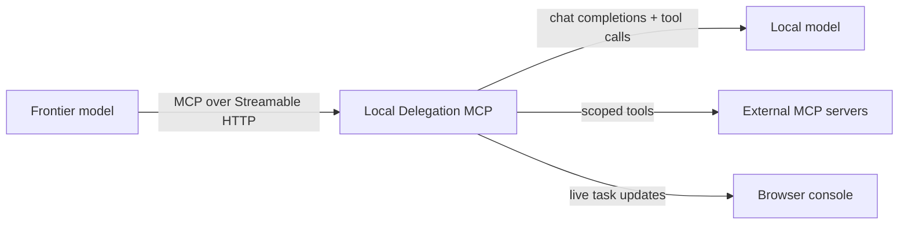

# Local Delegation MCP

**Give a frontier model a local teammate.** Local Delegation MCP is a .NET 10 server that lets an MCP-connected model hand substantial work to an OpenAI-compatible model running on your own machine, then check progress, answer questions, and review the result.

The local model gets its own tool-calling loop. You can also connect other MCP servers and choose which model is allowed to use each server's tools.

## What it does

- **Delegate work** synchronously or in the background, with completion criteria.
- **Follow tasks live** through progress notes, task status, and a browser conversation console.
- **Handle clarification** by letting the local model ask a question, then resume the same task with your answer.
- **Keep context across follow-up work** by continuing a completed task session.
- **Extend both models** with tools from external MCP servers, scoped to the frontier model, local model, or both.
- **Run locally** with an OpenAI-compatible chat completions endpoint such as LM Studio or llama.cpp.

## How it fits together



The frontier model connects to `/mcp`. The server runs the local model's tool loop, stores task sessions in memory, and serves the web console at `/`. The console streams updates with server-sent events.

## Quick start

### Requirements

- [.NET 10 SDK](https://dotnet.microsoft.com/download/dotnet/10.0)
- A local server that exposes an OpenAI-compatible **chat completions** API
- Optional: external MCP servers reachable over stdio or Streamable HTTP

### 1. Start your local model server

Start LM Studio, llama.cpp, or another compatible server. Note the API base URL and the model identifier it expects. The default configuration uses `http://localhost:1234/v1` and `local-model`.

### 2. Configure the server

Edit `delegation.config.json` in the project directory. Set `openAi.baseUrl`, `openAi.model`, and, if your endpoint requires it, `openAi.apiKey`.

```json
{
  "listenPort": 8765,
  "openAi": {
    "baseUrl": "http://localhost:1234/v1",
    "apiKey": "lm-studio",
    "model": "local-model"
  },
  "agent": {
    "maxIterationsPerTask": 25,
    "maxConcurrentTasks": 4,
    "llmRequestTimeoutSeconds": 300
  },
  "externalMcpServers": []
}
```

Keep credentials out of commits. For personal settings, use a separate config file and pass its path when launching the server.

### 3. Run it

```powershell
dotnet run --project LocalDelegationMcp.csproj
```

To use a config file at a different path:

```powershell
dotnet run --project LocalDelegationMcp.csproj -- C:\path\to\delegation.config.json
```

The server listens on port `8765` by default:

| URL | Purpose |
|---|---|
| `http://localhost:8765/` | Live task and conversation console |
| `http://localhost:8765/mcp` | Streamable HTTP MCP endpoint |
| `http://localhost:8765/health` | Health and configuration summary |

The task API and event stream are limited to loopback clients. The MCP endpoint is available on the configured listen port for MCP clients on your network; use your network's firewall and access controls accordingly.

### 4. Connect your frontier model

Add the server as a remote MCP server in your frontier model's MCP client using `http://localhost:8765/mcp`. The client must support Streamable HTTP. The exact setup varies by client; use its remote MCP server settings and provide the URL above.

## Tools

### Frontier model

| Tool | Use it to |
|---|---|
| `delegate_task` | Run work and return the result or a clarification request. |
| `delegate_task_async` | Start work in the background and get a task ID. |
| `pending_tasks` | List running and clarification-waiting tasks. |
| `task_status` | Read a task's status, latest progress, result, question, or error. |
| `clarify` | Answer a waiting task and resume it in the background. |
| `stop_task` | Cancel a running or clarification-waiting task. |
| `describe_capabilities` | Ask the local model to describe its available tools and abilities. |

Completed sessions can be continued by passing their `task_id` to `delegate_task` or `delegate_task_async`. The previous conversation is retained and the new work is appended.

### Local model

The local model receives `complete_task`, `clarify_task`, and `report_progress`, plus external tools in the `local` and `global` scopes. It should call `report_progress` at meaningful milestones on longer tasks; the frontier model can read the latest note through `task_status` or `pending_tasks`.

## External MCP servers

Add server entries to `externalMcpServers` in `delegation.config.json`. Each entry has a unique `name`, a `scope` (`frontier`, `local`, or `global`), and a `transport` (`stdio` or `http`). A `global` server's tools are available to both models.

- **stdio** entries use `command`, optional `args`, `workingDirectory`, and `environmentVariables`.
- **HTTP** entries use `url` and optional `headers`.

Proxied tools are named `{serverName}_{toolName}`. If one external server fails to connect at startup, the server logs the failure and continues with other configured servers.

## Configuration reference

| Field | Description |
|---|---|
| `listenPort` | HTTP port (default `8765`). |
| `openAi.baseUrl` | Absolute HTTP(S) API base URL. `/chat/completions` is appended. |
| `openAi.apiKey` | Optional bearer token for the local endpoint. |
| `openAi.model` | Model identifier sent with each completion request. |
| `agent.maxIterationsPerTask` | Maximum local-model requests per task (default `25`). |
| `agent.maxConcurrentTasks` | Maximum running or clarification-waiting tasks (default `4`). |
| `agent.llmRequestTimeoutSeconds` | Timeout for each local-model request (default `300`). |
| `agent.systemPrompt` | Instructions prepended to each delegated task. |
| `externalMcpServers` | Optional external stdio or Streamable HTTP MCP servers. |

## Build and test

```powershell
dotnet build LocalDelegationMcp.csproj
dotnet test tests/LocalDelegationMcp.Tests.csproj
```

Tests use a fake LLM and an in-memory MCP transport, so they do not need a running model or external MCP service.

## Task storage

Task sessions live in memory and are cleared when the server exits. Save any results you need before shutting down the process.
